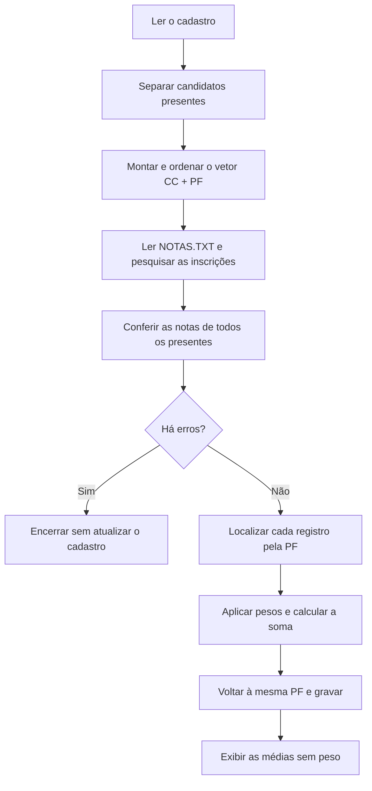

<p align="center">
  
</p>

<h1 align="center">N08EVANDRO Visual</h1>

<p align="center">
  Um laboratório interativo para entender um programa Pascal vendo seus dados, suas variáveis e seus cálculos em ação.
</p>

<p align="center">
  
  
  
  
</p>

<p align="center">
  <a href="#sobre-o-projeto">Sobre</a> ·
  <a href="#funcionalidades">Funcionalidades</a> ·
  <a href="#executar-localmente">Executar</a> ·
  <a href="#estrutura-do-projeto">Estrutura</a> ·
  <a href="#publicar-no-vercel">Deploy</a>
</p>

## Sobre o projeto

O **N08EVANDRO Visual** transforma a lógica do programa `N08EVANDRO.pas` em uma experiência de aprendizado no navegador. Foi criado para apoiar o estudo e a apresentação do trabalho 08 da disciplina **DS110**, permitindo relacionar cada trecho do Pascal ao que acontece com os dados.

O programa original atualiza as notas de candidatos presentes em um concurso. Este simulador torna esse processo visível: mostra a formação do vetor de busca, a pesquisa por inscrição, a conferência das notas, a aplicação dos pesos e o cálculo das médias.

O código Pascal de **Evandro Lima Barbosa** acompanha o projeto e é apresentado em **24 blocos explicados**, com seus nomes de variáveis e números de linha preservados.

## Funcionalidades

### Aula guiada para quem está começando

Abra **`debug.html`** ou clique em **Começar aula guiada** no laboratório. Esse modo usa um exemplo pequeno, com dois presentes e um ausente, e apresenta uma instrução por vez.

- Começa por `FILE OF regis`, `regis`, `ASSIGN`, `RESET` e `READ`.
- Destaca as linhas originais e mostra valores **antes e depois** de cada comando.
- Separa visualmente o arquivo guardado da ficha na memória.
- Permite avançar, voltar, trocar de capítulo e reproduzir como uma aula automática.
- Oferece leitura em voz alta quando o navegador tem suporte e uma voz disponível.
- Inclui pequenas pausas para pensar, com resposta opcional.
- Percorre cinco cenários: normal, nota inválida, duplicidade, presente sem notas e todos ausentes.

A aula é uma simulação didática, não uma execução do compilador Pascalzim. A narração usa as vozes do navegador e pode depender do sistema e da conexão.

| Recurso | O que você acompanha |
| --- | --- |
| **Execução passo a passo** | Avance, volte ou reproduza a sequência automaticamente, com controle de velocidade. |
| **Código original explicado** | Leia cada bloco Pascal, veja seus números de linha e vá ao passo correspondente da simulação. |
| **Vetor CC + PF** | Entenda a diferença entre inscrição, índice do vetor e posição física no cadastro. |
| **Pesquisa binária visual** | Observe o intervalo da busca e o elemento escolhido como meio. |
| **Variáveis ao vivo** | Acompanhe contadores, marcas de recebimento e acumuladores com os nomes do programa. |
| **Validação dos dados** | Experimente notas inválidas, duplicidades e candidatos presentes sem notas. |
| **Pesos e médias** | Veja por que o total do candidato usa pesos e a média da disciplina usa as notas originais. |
| **Entrada editável** | Modifique candidatos e notas, gere linhas de TXT e importe ou exporte arquivos. |
| **Pascal e JavaScript** | Compare os trechos originais com suas equivalências didáticas. |

### Telas disponíveis

- **Laboratório:** execução visual, cadastro, vetor de busca, linha de notas, cálculos e resultados.
- **Seu código Pascal:** navegação pelos 24 blocos, explicações e visualização do arquivo completo.
- **Dados de entrada:** edição do cadastro e do TXT, importação, exportação e gerador de linhas.
- **Conceitos básicos:** explicações de registros, arrays, índices, pesquisa binária e operações com arquivos.

## Executar localmente

**Basta abrir o `index.html` no navegador.** O site funciona sem instalação, sem servidor e sem internet depois de baixado.

1. Baixe o projeto em **Code → Download ZIP**.
2. Extraia o arquivo.
3. Abra `index.html`.

Para começar, mantenha o cenário **Tudo certo · exemplo completo** e clique em **Começar simulação**. Avance pelo fluxo e, depois, selecione um dos cenários com erro para observar o bloqueio da gravação.

## A lógica por trás da simulação



### Disciplinas e pesos

| Disciplina | Peso |
| --- | ---: |
| L.E.M. | 1 |
| Matemática | 1 |
| Lógica | 1 |
| Conhecimento específico | **3** |
| Informática | **2** |
| Atualidades | 1 |

Por exemplo, as notas originais `[80, 70, 60, 90, 85, 75]` produzem as notas com peso `[80, 70, 60, 270, 170, 75]`, totalizando **725 pontos**. Para a média de cada disciplina, continuam sendo utilizadas as notas originais.

### Arquivo de notas

Cada linha de `NOTAS.TXT` tem **28 caracteres**: quatro para a inscrição e seis campos de quatro caracteres para as notas.

```text
0012  80  70  60  90  85  75
```

Os espaços fazem parte dos campos. A interface oferece um gerador para montar linhas nesse formato.

## Tecnologias e arquitetura

| Tecnologia | Responsabilidade |
| --- | --- |
| **HTML5** | Estrutura das telas e dos controles. |
| **CSS3** | Apresentação visual e layout responsivo. |
| **JavaScript** | Algoritmo, etapas da simulação e atualização da interface. |
| **Node.js** | Execução opcional dos testes e geração dos trechos do Pascal. |
| **Vercel** | Configuração incluída para publicação estática. |

O núcleo da simulação fica separado da interface: `engine.js` produz os passos e calcula as alterações; `app.js` conecta os resultados aos controles e elementos da página.

**Toda a execução acontece no navegador.** O projeto não utiliza backend, banco de dados ou dependências externas de execução. As edições ficam na memória da aba e são descartadas ao recarregar a página. Para guardá-las, utilize a exportação e importe os arquivos em uma próxima sessão.

O cadastro binário `CAND.IND` é representado por registros em memória. O simulador trabalha com JSON e TXT e não modifica o arquivo original do Pascal.

## Estrutura do projeto

```text
n08evandro-visual/
├── index.html              # Telas da aplicação
├── styles.css              # Estilos e responsividade
├── app.js                  # Interface, navegação e controles
├── engine.js               # Algoritmo e passos da simulação
├── debug.html              # Aula com uma instrução por vez
├── debug.css               # Apresentação da aula guiada
├── debug.js                # Controles e narração opcional
├── debug-engine.js         # Quadros detalhados da depuração
├── original-source.js      # Pascal original e explicações
├── N08EVANDRO.pas          # Programa Pascal estudado
├── docs/
│   └── banner.svg          # Apresentação do repositório
├── scripts/
│   └── prepare-source.cjs  # Geração dos blocos do Pascal
├── tests.cjs               # Verificações do algoritmo
├── package.json            # Comandos de desenvolvimento
├── vercel.json             # Configuração de publicação
└── README.md
```

## Testes

Com **Node.js** instalado, execute na raiz do projeto:

```bash
npm test
```

Não é necessário executar `npm install`: o projeto não possui dependências de pacote.

Para gerar uma cópia com os estilos e scripts embutidos, execute `npm run offline`. Abra `offline/debug.html` para a aula ou `offline/index.html` para o laboratório. Para servir localmente por HTTP, execute `npm start` e acesse o endereço exibido no terminal.

As verificações cobrem aplicação dos pesos, médias sem peso, correspondência entre inscrição e posição física, preservação dos ausentes, validação, duplicidades, presentes sem notas, ausência de presentes e reposicionamento antes da gravação. Também conferem os trechos do Pascal e seus intervalos de linha.

Para regenerar o arquivo de explicações após editar os textos em `scripts/prepare-source.cjs`:

```bash
npm run source
```

Se alterar a estrutura do Pascal, ajuste também os intervalos de linha definidos nesse script.

## Publicar no Vercel

1. Envie os arquivos para seu repositório no GitHub, mantendo `index.html` na raiz.
2. No Vercel, crie um projeto e importe o repositório.
3. Mantenha a raiz do repositório como diretório do projeto.
4. Clique em **Deploy**.

O `vercel.json` incluído já define as configurações:

| Configuração | Valor |
| --- | --- |
| Framework Preset | `Other` |
| Build Command | Vazio |
| Install Command | Vazio |
| Output Directory | `.` |

Não são necessárias variáveis de ambiente nem configuração de banco de dados.

## Escopo didático

A página simula a lógica do programa; ela não compila Pascal nem reproduz o formato binário de seus arquivos. A ordenação mostra o resultado de `ORDEM`, e a animação da pesquisa representa o trabalho de `PEBIN1`, rotinas da unit `TARDENOITE`.

A interface também explicita duas diferenças: os vetores do Pascal deste programa começam em **1**, enquanto os arrays JavaScript começam em **0**; e o cursor de `SEEK`, `READ` e `WRITE` é representado visualmente para explicar as operações do original.

## Autor

**Evandro Lima Barbosa**  
Programa original: `N08EVANDRO.pas` · Disciplina: **DS110** · Trabalho: **08**

Interface e adaptação didática desenvolvidas com auxílio do Codex.
